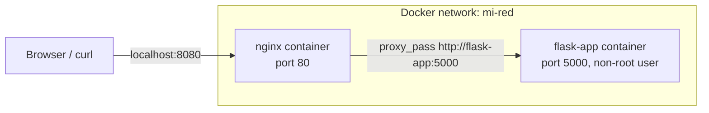

# Nginx + Flask: Multi-Container Lab with Docker Compose and Kubernetes Manifests

A hands-on lab I built while studying Computer Engineering at FIUBA (University of Buenos Aires) to practice containers, reverse proxies, Bash automation and Kubernetes basics.

A small Flask app runs behind an Nginx reverse proxy with Docker Compose. A Bash script checks that the stack is healthy, and a pair of Kubernetes manifests describes how the app would run on a cluster.

## Architecture



- **Flask app** (`app.py`): a minimal Python 3.11 web app that returns a text response on port 5000. The container runs as an unprivileged user (`appuser`) and defines a Docker `HEALTHCHECK`.
- **Nginx** (`nginx/default.conf`): the only service published to the host (port `8080` → `80`). It forwards requests to Flask using Docker's internal DNS name `flask-app`, adds the usual proxy headers (`X-Real-IP`, `X-Forwarded-For`, `X-Forwarded-Proto`) and hides its version (`server_tokens off`).
- **Docker Compose** (`docker-compose.yml`): builds the Flask image, starts both containers on a user-defined bridge network and starts Nginx after Flask.

## Repository structure

```
.
├── app.py                     # Flask application
├── Dockerfile                 # Flask image (python:3.11-slim, non-root user, healthcheck)
├── docker-compose.yml         # Flask + Nginx on a shared network
├── requirements.txt
├── nginx/default.conf         # Reverse proxy configuration
├── scripts/healthcheck.sh     # Bash health check with logging
└── k8s-manifests/
    ├── flask-deployment.yaml  # Deployment with 2 replicas of the Flask app
    └── flask-service.yaml     # ClusterIP Service in front of the replicas
```

## Run it locally

Requirements: Docker with Docker Compose.

```bash
git clone https://github.com/delfipani/docker-nginx-flask-infrastructure.git
cd docker-nginx-flask-infrastructure

# Build and start the stack in the background
docker compose up -d --build

# Open http://localhost:8080 or:
curl http://localhost:8080

# Check the Docker health status of the Flask container
docker inspect --format '{{.State.Health.Status}}' flask-app

# Stop everything
docker compose down
```

## Health check script

`scripts/healthcheck.sh` checks three things and appends the results, with timestamps, to `scripts/status.log` (ignored by Git):

1. The Docker daemon is running.
2. The `flask-app` and `nginx` containers are up.
3. `http://localhost:8080` answers with HTTP 200 through the reverse proxy.

The script exits with status `1` if any check fails, so it can be used from cron or a CI job.

```bash
bash scripts/healthcheck.sh
```

## Kubernetes manifests

The `k8s-manifests/` folder describes the Flask app for a cluster:

- `flask-deployment.yaml`: a Deployment that keeps **2 replicas** of the Flask Pod running (fixed number; there is no autoscaling).
- `flask-service.yaml`: a `ClusterIP` Service that gives those replicas one stable internal address and spreads traffic between them.

Scope and current status:

- Only the Flask app is described; Nginx is not part of the manifests yet.
- A `ClusterIP` Service is reachable only from inside the cluster. To try it from your machine you would use `kubectl port-forward`, a `NodePort` or an Ingress.
- The Deployment uses the locally built image with `imagePullPolicy: Never`, which is meant for a local cluster such as minikube or kind.
- So far the manifests have been checked with a client-side dry run, which only confirms that the files parse as Kubernetes objects:

```bash
kubectl apply -f k8s-manifests/ --dry-run=client --validate=false
```

To run them on a local cluster (minikube example):

```bash
docker compose build
minikube image load docker-nginx-flask-infrastructure-flask-app:latest
kubectl apply -f k8s-manifests/
kubectl port-forward service/flask-app-service 5000:5000
curl http://localhost:5000
```

## What I practiced

- Writing a Dockerfile with a slim base image, a non-root user and a container health check.
- Running several containers on a shared network and connecting them by service name.
- Configuring Nginx as a reverse proxy.
- Automating checks in Bash (exit codes, `docker ps` filters, `curl` status codes, logging).
- Describing an app declaratively with a Kubernetes Deployment and Service.

## Known limitations

- Flask runs with its built-in development server; a production setup would use a WSGI server such as Gunicorn.
- No TLS: Nginx serves plain HTTP on port 8080.
- The Kubernetes manifests have no resource limits, readiness/liveness probes or Nginx/Ingress yet.
- There is no CI pipeline yet.

## Next steps

- Add readiness and liveness probes and resource requests/limits to the Deployment.
- Run the manifests on a local cluster (minikube or kind) and document the result.
- Add a GitHub Actions workflow that builds the image and runs the health check.
- Deploy the stack on AWS as part of my cloud learning roadmap.
